# azure-incident-tracker

A three-tier web app provisioned on Azure with **Terraform**, configured and deployed with **Ansible**, and delivered through **GitHub Actions** using **OIDC** (no stored cloud credentials).

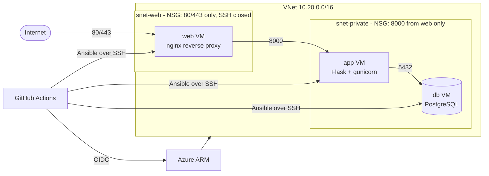

## What it demonstrates

- Infrastructure as code with remote state in Azure Storage (Entra auth, no storage keys).
- Network segmentation: separate subnets and NSGs per tier; the app is reachable only from the web tier.
- Idempotent configuration management with Ansible roles (`common`, `node_exporter`, `postgres`, `app`, `nginx_web`).
- Keyless CI/CD: GitHub OIDC federation, plan on pull request, manually triggered apply, manual destroy.
- Cost controls: small B-series VMs, nightly auto-shutdown, budget alerts, one-command teardown.

## Layout

```
app/          Flask incident tracker (see app/ and tests/)
terraform/    network, NSGs, VMs, auto-shutdown, outputs
ansible/      site.yml, roles/, inventory/group_vars (inventory is generated)
scripts/      bootstrap.sh (state + OIDC), gen_inventory.py
.github/      ci, terraform, deploy and destroy workflows
```

## Design notes and trade-offs

- **Public IPs on every VM.** New Azure VNets may not provide default outbound internet access, and a NAT gateway costs far more than this lab. So each VM gets a public IP, but NSGs block all inbound traffic except HTTP/HTTPS to the web tier and there is no standing SSH rule (see the next note). Set `public_ip_for_private_tier = false` and add a NAT gateway for a stricter production-style layout.
- **Deploy from a GitHub-hosted runner with a temporary SSH rule.** Ansible needs SSH, and GitHub runners have a different IP every run. The deploy job looks up its own IP, adds an NSG rule allowing SSH from that single address, runs Ansible, and always removes the rule afterwards (even on failure). No home IP is stored anywhere: `allowed_ssh_cidr` defaults to empty, so there is no standing SSH rule. To log in by hand, run `./scripts/ssh-window.sh open` (it looks up your current IP at run time) and `close` when you are done.
- **VM size follows quota, not preference.** The stack uses `Standard_D2ls_v6` because this subscription had no capacity for B1s and no quota for the newer B-series in `centralus`. Check `az vm list-skus` and `az vm list-usage` before choosing a size for your own subscription.
- **Apply is manual.** Plans run on pull requests and pushes; `apply` only runs when started from the Actions tab. (Environment required reviewers are not available for private repositories on every GitHub plan.)
- **PostgreSQL on a VM, not the managed service**, to keep cost down. The app reads `DATABASE_URL`, so switching to Azure Database for PostgreSQL later only changes the env file.
- **Tables are created on app start** (`db.create_all()`). Fine for a demo; use migrations for real data.

## Setup runbook

Prerequisites: Azure CLI, Git, an SSH key pair for the VMs, and a private GitHub repo.

1. **Bootstrap Azure** (once):
   ```bash
   az login
   GH_REPO=<owner>/<repo> ./scripts/bootstrap.sh
   ```
   It creates the state storage account, an Entra app with GitHub OIDC federated credentials, and role assignments, then prints the values to configure in GitHub.
2. **Configure GitHub:** add the printed repository *variables*, add the *secrets* (`ADMIN_SSH_PUBLIC_KEY`, `ANSIBLE_SSH_PRIVATE_KEY`, `DB_PASSWORD`), and create the environments `azure-apply`, `azure-destroy` and `azure-deploy` (require your approval on apply and destroy).
3. **Database password.** The deploy workflow passes the `DB_PASSWORD` secret to Ansible as an extra variable (letters and digits only, because it is placed in a SQL statement). To keep the password in the repo instead, use Ansible Vault:
   ```bash
   cp ansible/inventory/group_vars/all/vault.yml.example ansible/inventory/group_vars/all/vault.yml
   # edit the password, then:
   ansible-vault encrypt ansible/inventory/group_vars/all/vault.yml
   ```
4. **Provision:** open a pull request to see `terraform plan`, merge, then start the `terraform` workflow by hand (Run workflow) to apply.
5. **Deploy:** run the `deploy` workflow. It generates the inventory from Terraform outputs, runs the playbook and smoke-tests `/healthz` through the web tier.
6. **Tear down:** run the `destroy` workflow and type `destroy`.

Local equivalent of steps 4-5:
```bash
cd terraform
cp terraform.tfvars.example terraform.tfvars   # fill in
terraform init -backend-config="resource_group_name=rg-tfstate" \
  -backend-config="storage_account_name=<sa>" -backend-config="container_name=tfstate" \
  -backend-config="key=incident-tracker.tfstate"
terraform apply
terraform output -json vms | python3 ../scripts/gen_inventory.py > ../ansible/inventory/hosts.yml
cd ../ansible && ansible-playbook site.yml --ask-vault-pass
```

## Cost

Three small VMs, three Standard public IPs and three small disks. Approximate list prices are a few cents per VM per hour while running, plus a small hourly charge per public IP and disk storage; verify current numbers in the Azure pricing calculator. Auto-shutdown deallocates VMs nightly (static public IPs and disks still bill), and `destroy` removes everything. Keep a budget alert on the subscription and destroy the stack when you are not using it.

## Results

This stack was applied to a real Azure subscription, deployed, tested and destroyed. Evidence from that run:

**Terraform plan** from the pipeline: 20 resources to add, nothing to change or destroy, reviewed before any apply:

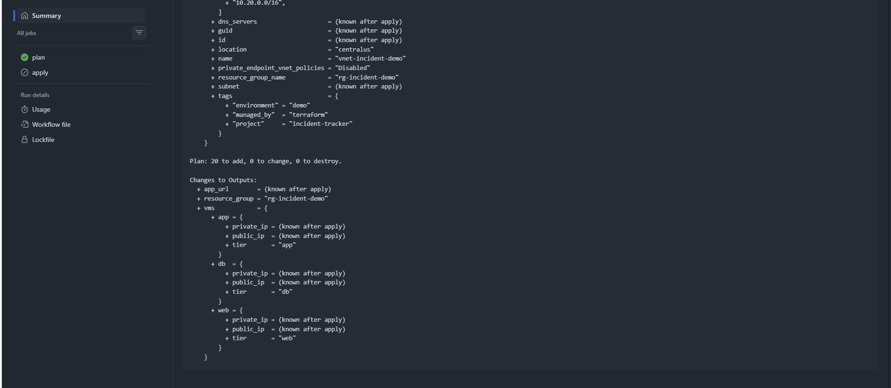

**Infrastructure applied by the pipeline** (keyless OIDC login; 20 Terraform resources, 15 of which show up as portal resources):

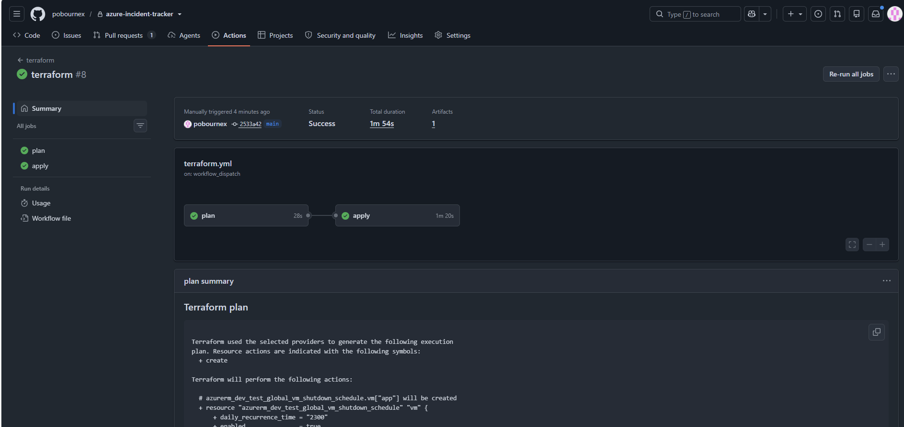

**Resource group** with the VMs, NICs, public IPs, NSGs and VNet, all tagged `managed_by: terraform`:

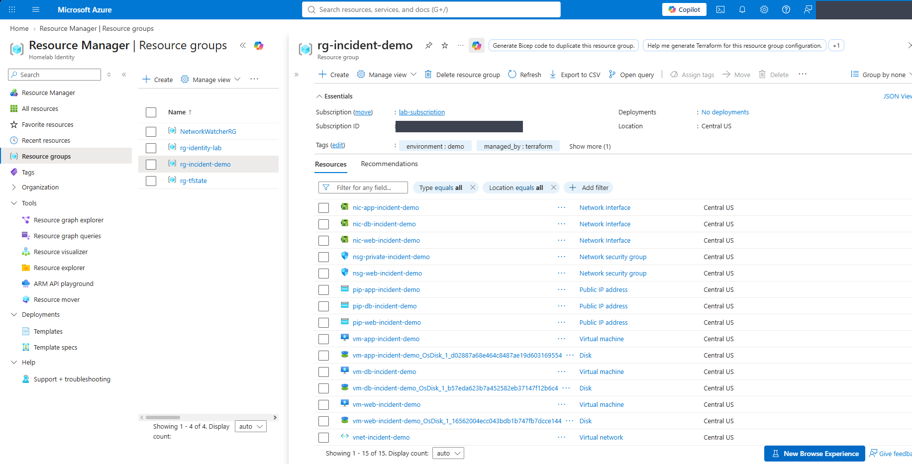

**Network segmentation:** two subnets, each with its own NSG:

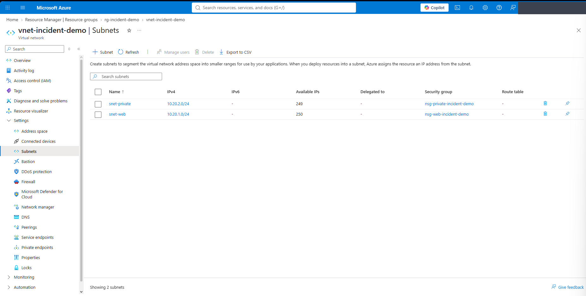

**Web NSG:** only HTTP/HTTPS from the internet and metrics from inside the VNet. There is no SSH rule:

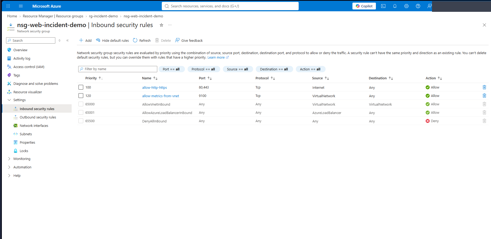

**Ansible deploy** from a GitHub-hosted runner (temporary SSH rule opened and closed automatically):

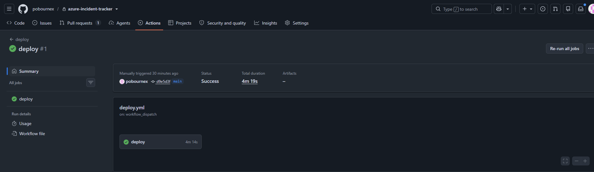

**The app running** on the web VM's public IP, with incident status changes saved in PostgreSQL on the db VM:

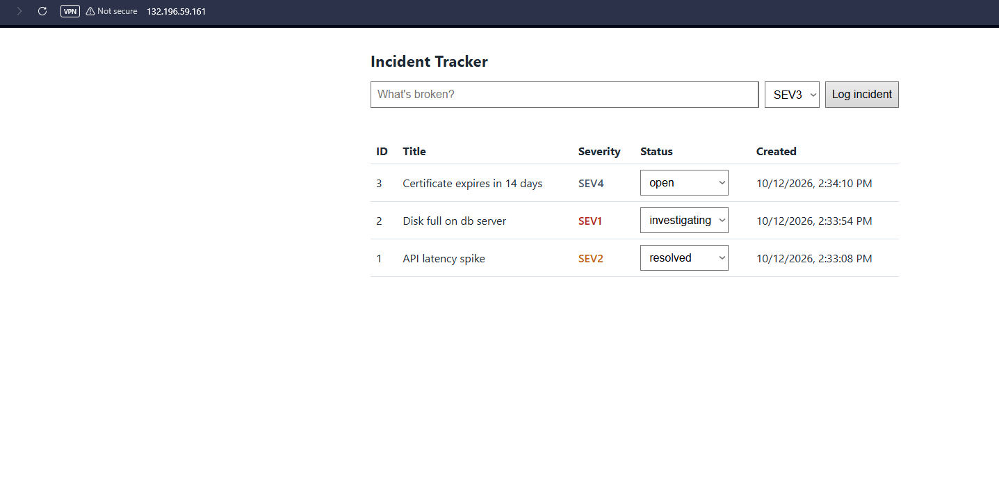

**Health check** proves all three tiers are connected (nginx on web, Flask on app, PostgreSQL on db):

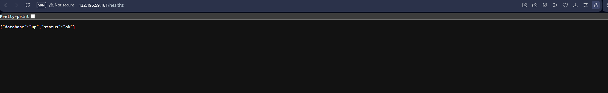

**Metrics are not exposed** through the web tier (nginx returns 404 for `/metrics`):

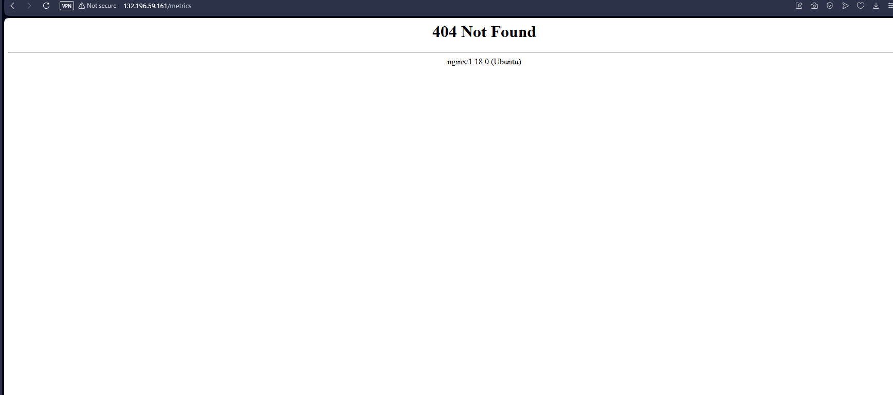

**Teardown:** the destroy workflow removed everything, leaving only the Terraform state account:

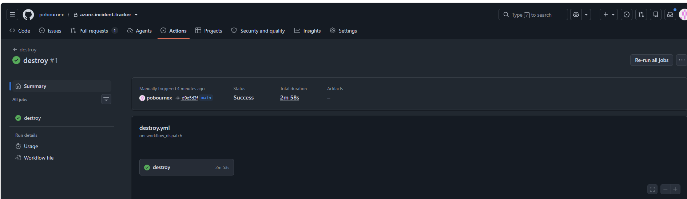

## Problems I hit and how I fixed them

1. **OIDC login failed with AADSTS700213.** GitHub now puts immutable IDs in the OIDC subject claim (`repo:owner@<id>/repo@<id>:...`), so federated credentials created with the plain repository name did not match. I read the exact subject from the error and recreated the five federated credentials to match it.
2. **`SkuNotAvailable` for Standard_B1s in centralus.** This is a capacity restriction, which a plan cannot predict. I queried `az vm list-skus` across regions to see what was unrestricted.
3. **`OperationNotAllowed`: quota of 0 for the B-series v2 family.** Capacity and quota are different problems. I listed the subscription's quotas with `az vm list-usage`, then chose a size from a family that had both quota and capacity (`Standard_D2ls_v6`).
4. **No required-reviewer gate for environments** on my GitHub plan for private repositories. Rather than let a push to `main` auto-apply, I made apply a manual `workflow_dispatch` run, with plan on every pull request.
5. **No Ansible installed on my Windows machine.** I replaced the local vault step with a GitHub secret passed to Ansible as an extra variable. Ansible Vault remains supported in the roles.

## What I would do next

- Add a bastion or jump host so the private tier has no public IPs (needs a NAT gateway or equivalent for outbound access).
- Replace the PostgreSQL VM with Azure Database for PostgreSQL Flexible Server.
- Add TLS in front of nginx and a basic availability alert.
- Re-run the same pipeline from a Jenkinsfile to compare the two CI systems.
