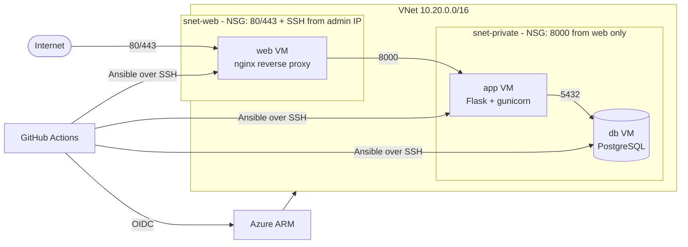

# azure-incident-tracker

A three-tier web app provisioned on Azure with **Terraform**, configured and deployed with **Ansible**, and delivered through **GitHub Actions** using **OIDC** (no stored cloud credentials).



## What it demonstrates

- Infrastructure as code with remote state in Azure Storage (Entra auth, no storage keys).
- Network segmentation: separate subnets and NSGs per tier; the app is reachable only from the web tier.
- Idempotent configuration management with Ansible roles (`common`, `node_exporter`, `postgres`, `app`, `nginx_web`).
- Keyless CI/CD: GitHub OIDC federation, plan on pull request, manually triggered apply, manual destroy.
- Cost controls: small B-series VMs, nightly auto-shutdown, budget alerts, one-command teardown.

## Layout

```
app/          Flask incident tracker (see app/ and tests/)
terraform/    network, NSGs, VMs, auto-shutdown, outputs
ansible/      site.yml, roles/, inventory/group_vars (inventory is generated)
scripts/      bootstrap.sh (state + OIDC), gen_inventory.py
.github/      ci, terraform, deploy and destroy workflows
```

## Design notes and trade-offs

- **Public IPs on every VM.** New Azure VNets may not provide default outbound internet access, and a NAT gateway costs far more than this lab. So each VM gets a public IP, but NSGs block all inbound traffic except HTTP/HTTPS to the web tier and there is no standing SSH rule (see the next note). Set `public_ip_for_private_tier = false` and add a NAT gateway for a stricter production-style layout.
- **Deploy from a GitHub-hosted runner with a temporary SSH rule.** Ansible needs SSH, and GitHub runners have a different IP every run. The deploy job looks up its own IP, adds an NSG rule allowing SSH from that single address, runs Ansible, and always removes the rule afterwards (even on failure). No home IP is stored anywhere: `allowed_ssh_cidr` defaults to empty, so there is no standing SSH rule. To log in by hand, run `./scripts/ssh-window.sh open` (it looks up your current IP at run time) and `close` when you are done.
- **PostgreSQL on a VM, not the managed service**, to keep cost down. The app reads `DATABASE_URL`, so switching to Azure Database for PostgreSQL later only changes the env file.
- **Tables are created on app start** (`db.create_all()`). Fine for a demo; use migrations for real data.

## Setup runbook

Prerequisites: Azure CLI, Git, an SSH key pair for the VMs, and a private GitHub repo.

1. **Bootstrap Azure** (once):
   ```bash
   az login
   GH_REPO=<owner>/<repo> ./scripts/bootstrap.sh
   ```
   It creates the state storage account, an Entra app with GitHub OIDC federated credentials, and role assignments, then prints the values to configure in GitHub.
2. **Configure GitHub:** add the printed repository *variables*, add the *secrets* (`ADMIN_SSH_PUBLIC_KEY`, `ANSIBLE_SSH_PRIVATE_KEY`, `ANSIBLE_VAULT_PASSWORD`), and create the environments `azure-apply`, `azure-destroy` and `azure-deploy` (require your approval on apply and destroy).
3. **Create the vault file and commit it encrypted:**
   ```bash
   cp ansible/inventory/group_vars/all/vault.yml.example ansible/inventory/group_vars/all/vault.yml
   # edit the password, then:
   ansible-vault encrypt ansible/inventory/group_vars/all/vault.yml
   ```
4. **Provision:** open a pull request to see `terraform plan`, merge, then start the `terraform` workflow by hand (Run workflow) to apply.
5. **Deploy:** run the `deploy` workflow. It generates the inventory from Terraform outputs, runs the playbook and smoke-tests `/healthz` through the web tier.
6. **Tear down:** run the `destroy` workflow and type `destroy`.

Local equivalent of steps 4-5:
```bash
cd terraform
cp terraform.tfvars.example terraform.tfvars   # fill in
terraform init -backend-config="resource_group_name=rg-tfstate" \
  -backend-config="storage_account_name=<sa>" -backend-config="container_name=tfstate" \
  -backend-config="key=incident-tracker.tfstate"
terraform apply
terraform output -json vms | python3 ../scripts/gen_inventory.py > ../ansible/inventory/hosts.yml
cd ../ansible && ansible-playbook site.yml --ask-vault-pass
```

## Cost

Three small VMs, three Standard public IPs and three small disks. Approximate list prices are a few cents per VM per hour while running, plus a small hourly charge per public IP and disk storage; verify current numbers in the Azure pricing calculator. Auto-shutdown deallocates VMs nightly (static public IPs and disks still bill), and `destroy` removes everything. Keep a budget alert on the subscription and destroy the stack when you are not using it.

## Evidence to capture while it runs

- Screenshots of the resource group, VNet and NSG rules in the portal.
- The `terraform plan` run summary and the approved `apply`.
- The `deploy` run and a screenshot of the app loading through the web VM's public IP.
- A short screen recording of `destroy` followed by a fresh rebuild.

## Status

Written and linted (`yamllint`, `ansible-lint` production profile, Ansible syntax check, app tests) but **not yet applied to a real Azure subscription**. Items to confirm on the first run: VM size availability in your region (Standard_B1s was unavailable in centralus, so the stack uses Standard_B2ats_v2), the Ubuntu 22.04 image reference, and the bootstrap script.
